# Satellite Change Intelligence

I started this project to understand how a neural network can find changes between two satellite
images of the same place — first *where* something changed, and then *what* it changed into.

The project grew into two connected studies on one PyTorch codebase. In the first, I trained and
tuned binary change detectors myself and studied how resolution and model size affect what they
find. In the second, I used those detectors to test a popular engineering idea: let a cheap detector
find the changed regions first, and run the expensive semantic model only there.

The central question of the second study:
> Under which accuracy and compute conditions is a two-stage semantic change detection system
> preferable to a single-stage one?

<p align="center"><picture>
<source media="(prefers-color-scheme: dark)" srcset="assets/readme/architecture_dark.png">
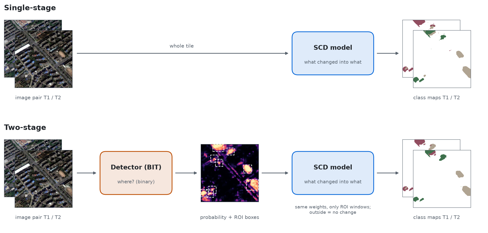
</picture></p>

**Short answer:** on the SECOND benchmark, no. The two-stage system is as accurate as the single
model, but it never needs less compute. It can pay off only when changes cover a small part of the
scene — see [When does the two-stage system pay off?](#when-does-the-two-stage-system-pay-off).

## Contents

- [Goal](#goal)
- [Progress Overview](#progress-overview)
- [Research 1 — Binary Change Detection](#research-1--binary-change-detection-levir-cd)
- [Research 2 — Single-Stage vs Two-Stage](#research-2--single-stage-vs-two-stage-semantic-change-detection-second)
- [Results](#results)
- [Error Analysis](#error-analysis)
- [Interactive Demo](#interactive-demo)
- [What I Learned](#what-i-learned)
- [Limitations](#limitations)
- [Next Steps](#next-steps)
- [Implementation Overview](#implementation-overview)
- [How to Run](#how-to-run)
- [Acknowledgements](#acknowledgements)

## Goal

The goal is to compare two ways of producing a semantic change map, under rules that make the
comparison fair:

1. **Single-stage:** one semantic change detection (SCD) model looks at the whole image pair and
   predicts the land-cover class before and after for every pixel.
2. **Two-stage:** a binary detector marks *where* something changed; regions of interest (ROI) are
   cut around these places; the same SCD model predicts *what* changed only inside the ROIs.
   Everything outside the ROIs is "no change".

Both systems are judged on two things at the same time:
- **accuracy** of the semantic change map;
- **compute** needed to produce it (forward FLOPs and measured latency).

A two-stage system only makes sense if it saves compute without losing accuracy. Saving compute is
its whole reason to exist.

## Progress Overview

| Period (2026) | Phase | Result |
|---|---|---|
| Aug 24 – Oct 7 | Research 1: training and HPO of three detector tiers × two input regimes on LEVIR-CD | six final detectors, 542 HPO trials |
| Oct 20 – Oct 30 | Research 1: hypotheses H1–H11 (resolution, object size, cost, ROI generation) | Full resolution is essential; the ROI policy drives the cost |
| Nov 6 – Nov 10 | Research 2, first iteration: one own SCD model vs one two-stage system, budget in GPU-hours | design did not match the intended study, GPU-hours varied 4–6× with server load → archived and redesigned |
| Nov 10 – Nov 13 | Research 2 design v2; detector screening on SECOND; pilot for the training budget | BIT (Medium) chosen; budget 3.2·10¹⁷ training FLOPs per run |
| Nov 16 – Nov 21 | HPO and final training of three SCD models (3 seeds), ROI policies on validation, protocol freeze | 12 frozen systems |
| Nov 21 – Nov 23 | Single read of the test split; analysis; latency; web demo; cost checks on larger scenes | results below |

The full story of both studies — hypotheses, key decisions and mistakes — is in
**[REPORT.md](REPORT.md)** (Part I: Research 1, Part II: Research 2).

## Research 1 — Binary Change Detection (LEVIR-CD)

### Dataset Setup

**LEVIR-CD** contains 637 pairs of 1024 × 1024 Google Earth images (0.5 m per pixel) with binary
masks of building changes. I used the official train / validation / test split.

Every model was trained in two input regimes:
1. **Full** — native 1024 × 1024 resolution;
2. **Resized** — the whole scene downscaled to 256 × 256 (16× fewer pixels, much cheaper).

### Models

| Tier | Model | Idea |
|---|---|---|
| Light | FC-Siam-Diff | small fully convolutional Siamese network; difference of features at every scale |
| Medium | BIT (ResNet-18 S4, 8-layer decoder) | CNN features + a transformer over a few "semantic tokens" |
| Heavy | Siamese MiT-B3 (SegFormer encoder) | hierarchical vision transformer, strongest and most expensive |

### Hyperparameter Search

I implemented and ran the hyperparameter search myself, in stages, and checked every stage before
starting the next one. The compute budget of this study was deliberately not limited, so that I
could try faster and slower schedules, larger and smaller grids, and come back to settings that
looked worse at first. The stages for BIT, for example, were:

1. learning rate × batch size;
2. architecture variants;
3. loss weights (BCE vs Dice);
4. weight decay;
5. learning-rate refinement;
6. joint batch-size / learning-rate check;
7. multi-seed confirmation of the best candidates (seeds 42, 123, 777);
8. final training (100 epochs, 3 seeds) and threshold selection on validation.

For the Heavy model I wrote a resumable, staged HPO controller (40 → 60 → 80 epochs) because
single trials took many hours on a shared server.

<p align="center">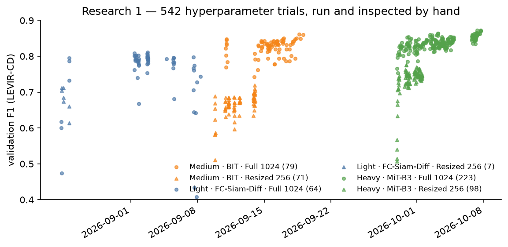</p>

The trial records (parameters, curves, best epoch, threshold, GPU time) are kept in
`artifacts/hyperparameter_search/`. The training notebooks were edited many times while the
training functions changed, so their code cells do not always match their saved outputs — the
artifacts are the reliable record. A guide to the notebooks is in
[`notebooks/research_1/README.md`](notebooks/research_1/README.md).

### Final Results (LEVIR-CD test, mean ± SD over 3 seeds)

| Tier | Model | F1 Full (1024²) | IoU Full | F1 Resized (256²) | IoU Resized |
|---|---|---:|---:|---:|---:|
| Light | FC-Siam-Diff | 0.805 ± 0.038 | 0.675 | 0.737 ± 0.018 | 0.584 |
| Medium | BIT | 0.846 ± 0.007 | 0.733 | 0.684 ± 0.023 | 0.520 |
| Heavy | Siamese MiT-B3 | **0.867 ± 0.003** | **0.765** | 0.746 | 0.595 |

### Hypotheses H1–H11

After the training I tested eleven hypotheses about *why* the models differ and *what it would
cost* to use them as the first stage of a two-stage system. Main findings:

- **Resolution matters more than model size for small objects.** Resized models are 6–20× faster
  but miss most small buildings: object-level recall drops from 0.64–0.79 (Full) to 0.07–0.32
  (Resized) on validation.
- **Pixel F1 and object recall can rank models differently.** BIT reaches a high pixel F1 but finds
  fewer separate buildings than FC-Siam-Diff.
- **The ROI policy decides the cost.** The same detector output can give 15 or 135 boxes, depending
  on how boxes are generated and merged.

<p align="center">
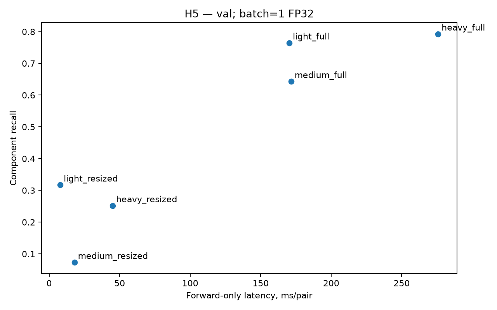
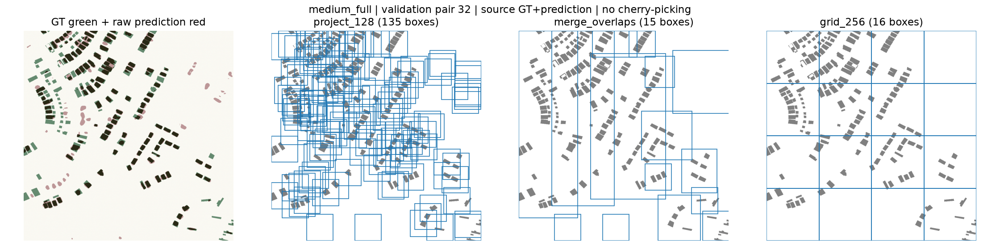
</p>

These results decided the detector candidates for Research 2 and introduced the main cost question:
how much of the image does the second stage still have to process?

## Research 2 — Single-Stage vs Two-Stage Semantic Change Detection (SECOND)

### Dataset Setup

**SECOND** contains 4 662 pairs of 512 × 512 aerial images with land-cover labels for both dates:
non-vegetated ground, tree, low vegetation, water, building, playground, and "no change".

- The official training set was split into **train 2 524 / validation 444** by filename groups
  (frozen manifest with file hashes).
- The official **test set (1 694 pairs)** was read **once**, after everything was frozen.

### Systems

| Case | System | Detector (*where*) | SCD model (*what*) |
|---|---|---|---|
| 1 | single-stage | — | whole tile |
| 2 | two-stage | BIT, pre-trained on LEVIR-CD, fine-tuned on SECOND | ROI context windows |
| 3 | two-stage | BIT trained on SECOND only | ROI context windows |
| 4 | two-stage | OR-ensemble: BIT ∨ FC-Siam-Diff (Resized) | ROI context windows |

Each case was combined with three SCD models of increasing complexity — **12 systems**:

| SCD model | Type | Forward GFLOPs per 512² tile |
|---|---|---:|
| Siamese U-Net + ResNet-18 | CNN | 119 |
| SCanNet + ResNet-34 | CNN + transformer | 537 |
| MambaSCD-Tiny | state-space model (Mamba) | 227 |

The two-stage systems use **exactly the same SCD checkpoint** as the single-stage system. Only the
input changes, so any difference comes from the detector and the cropping. Each ROI box is processed
in the smallest 128 / 256 / 384 / 512 window that contains it, so windows of equal size can be
batched on the GPU.

### Evaluation Protocol

To compare the systems fairly, I followed five rules:

1. **Equal training compute.** Every SCD model received the same budget in *training FLOPs*:
   6 HPO trials × 8·10¹⁶ + 3 final seeds × 3.2·10¹⁷ = 1.44·10¹⁸ FLOPs. Training stops at a
   pre-computed optimizer-step count, never by a timer, because GPU time on a shared server depends
   on other people's jobs.
2. **Own training.** Published SECOND checkpoints had seen our validation split (one was selected on
   the official test split), so I trained all three models myself and used the published weights
   only to check my reimplementations.
3. **Selection on validation only.** Hyperparameters, checkpoints, detector thresholds and ROI
   policies were chosen on the 444 validation tiles.
4. **Frozen protocol.** Hypotheses, the non-inferiority margin δ = 0.007 SeK, the density strata and
   the decision rule were frozen with file hashes before the test split was read.
5. **Pre-declared decision rule.** A two-stage system is *preferable* only if it is non-inferior in
   SeK (lower bound of the 95 % CI above −δ) **and** cheaper in FLOPs. If it is more accurate but
   more expensive, it is a *trade-off*. If it is not more accurate and more expensive, the
   single-stage system is preferable.

The implementation is in [`src/scripts/eval_r2_v2_systems.py`](src/scripts/eval_r2_v2_systems.py)
and [`src/scripts/analyze_r2_v2_systems.py`](src/scripts/analyze_r2_v2_systems.py).

### Metrics

| Value | Type | Meaning |
|---|---|---|
| `SeK` | primary metric | Separated Kappa: Cohen's kappa on the semantic confusion matrix *without* the dominant "no change → no change" cell, multiplied by `exp(IoU_change − 1)`. Punishes wrong classes and wrong localisation at the same time. |
| `mIoU`, `Fscd` | secondary metrics | mean IoU of change / no change; F1 of the semantic change classes |
| `ΔSeK` | comparison | two-stage − single-stage, with a 95 % CI from a paired scene bootstrap nested with 3 seeds |
| `FLOPs ×` | compute | forward FLOPs per tile relative to single-stage, detector included |
| `Latency ×` | compute | median per-tile wall-clock ratio (batch 1, fp32, A100) |

SeK values on SECOND are low by construction: published state-of-the-art models reach about
0.20–0.25.

### Training

<p align="center">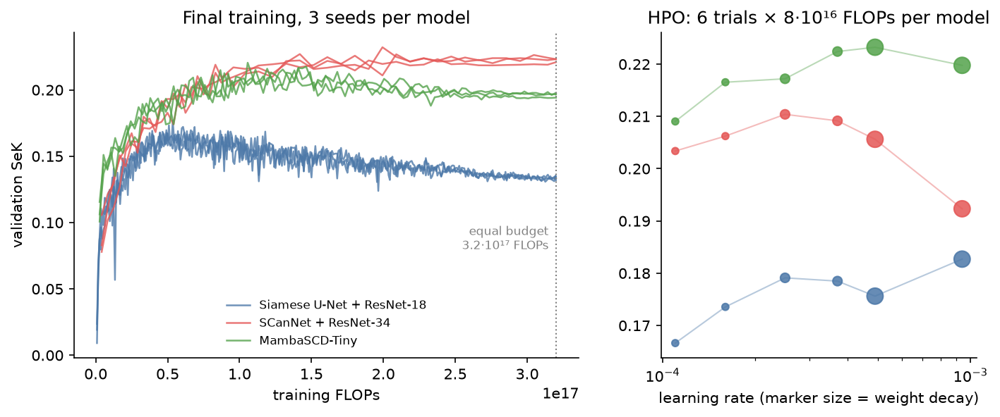</p>

At equal training FLOPs the light U-Net makes about 8× more optimizer steps than SCanNet; it reaches
its best validation SeK early and then slowly overfits. The best checkpoint of each run was selected
on validation.

### Examples

Three SECOND validation tiles with a small, medium and large share of changed pixels. Dashed boxes
are the ROIs of the two-stage system; the SCD model sees nothing outside them.

<p align="center">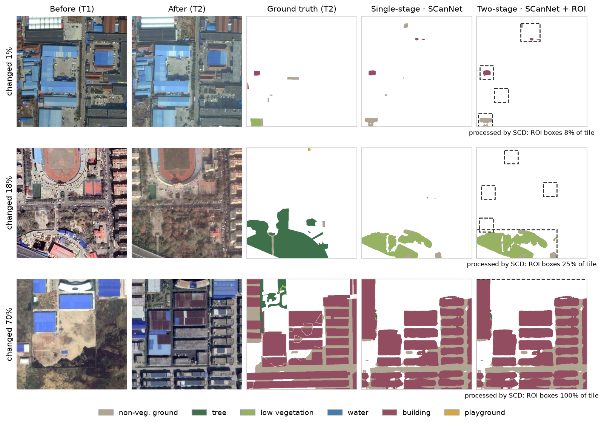</p>

## Results

### All 12 systems (SECOND test, 1 694 tiles, 3 seeds)

| SCD model | System | SeK | ΔSeK vs single (95 % CI) | Non-inferior (δ) | FLOPs × | Latency × | Verdict |
|---|---|---:|---:|:---:|---:|---:|---|
| Siamese U-Net | single-stage | 0.1853 | — | — | 1.00 | 1.00 | — |
| | two-stage · LEVIR-CD → SECOND | 0.1871 | +0.0018 (+0.0009…+0.0027) | yes | 2.14 | 2.45 | trade-off |
| | two-stage · SECOND only | 0.1870 | +0.0017 (+0.0006…+0.0027) | yes | 2.13 | 2.45 | trade-off |
| | two-stage · OR-ensemble | 0.1878 | +0.0025 (+0.0015…+0.0035) | yes | 2.06 | 2.29 | trade-off |
| SCanNet | single-stage | **0.2381** | — | — | 1.00 | 1.00 | — |
| | two-stage · LEVIR-CD → SECOND | 0.2341 | −0.0040 (−0.0053…−0.0027) | yes | 1.28 | 1.92 | single-stage better |
| | two-stage · SECOND only | 0.2331 | −0.0049 (−0.0065…−0.0034) | yes | 1.27 | 1.91 | single-stage better |
| | two-stage · OR-ensemble | 0.2337 | −0.0044 (−0.0060…−0.0029) | yes | 1.15 | 1.78 | single-stage better |
| MambaSCD | single-stage | 0.2329 | — | — | 1.00 | 1.00 | — |
| | two-stage · LEVIR-CD → SECOND | 0.2292 | −0.0038 (−0.0051…−0.0025) | yes | 1.62 | 1.99 | single-stage better |
| | two-stage · SECOND only | 0.2284 | −0.0046 (−0.0061…−0.0030) | yes | 1.61 | 1.95 | single-stage better |
| | two-stage · OR-ensemble | 0.2287 | −0.0043 (−0.0057…−0.0028) | yes | 1.51 | 1.79 | single-stage better |

None of the nine two-stage systems is *preferable* by the pre-declared rule: all are non-inferior in
accuracy, but all need more compute. LEVIR-CD pre-training of the detector (case 2 vs 3) and the
OR-ensemble (case 4 vs 2) gave no significant difference after Holm correction.

<p align="center">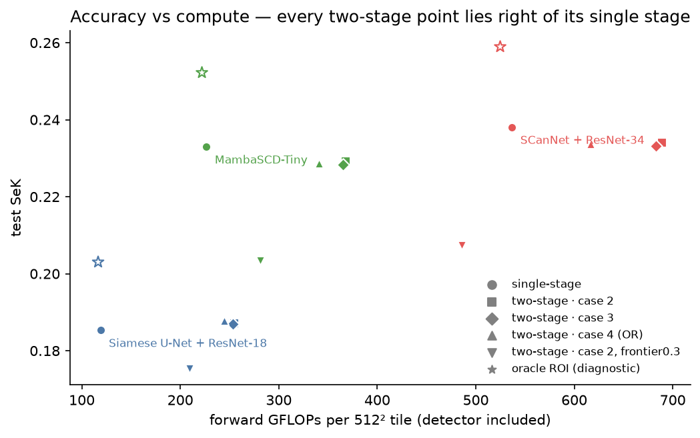</p>

### Where the two-stage system wins

ΔSeK of the two-stage system (case 2) against the single-stage system with the same SCD model,
under different conditions (95 % CI; **bold** = significantly better, *italic* = significantly worse):

| Condition | Siamese U-Net | SCanNet | MambaSCD |
|---|---|---|---|
| All tiles | **+0.0018** · FLOPs ×2.14 | *−0.0040* · ×1.28 | *−0.0038* · ×1.62 |
| Few changes (ρ < 0.115) | **+0.0030** (+0.0009…+0.0053) | *−0.0062* | *−0.0073* |
| Medium (0.115 ≤ ρ < 0.228) | +0.0007 (n.s.) | *−0.0071* | *−0.0069* |
| Many changes (ρ ≥ 0.228) | −0.0005 (n.s.) | *−0.0025* | *−0.0034* |
| Less area processed (policy frontier0.3) | *−0.0100* · ×1.76 | *−0.0307* · **×0.91** | *−0.0295* · ×1.24 |
| Perfect detector (ROI from ground truth, diagnostic) | +0.0177 · ×0.98 | +0.0209 · ×0.98 | +0.0193 · ×0.98 |

*ρ = share of changed pixels in a tile (terciles fixed on validation).*

<p align="center">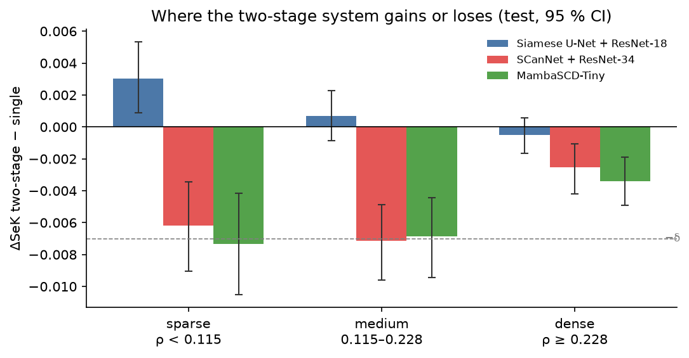</p>

- Only the weakest model (U-Net) gains accuracy, mostly on tiles with few changes — at about twice
  the FLOPs.
- The stronger models lose accuracy in every condition, least on tiles with many changes.
- Only one configuration is cheaper than its single stage (SCanNet with the aggressive frontier0.3
  policy), and it loses 0.031 SeK.
- A perfect detector would add about +0.02 SeK at slightly lower cost: the idea has headroom, but the
  real detector does not reach it.

### When does the two-stage system pay off?

After the main study I checked the compute side on larger real scenes (validation data only, compute
only — accuracy was not measured here). The relative cost of a two-stage system is

```text
FLOPs(two-stage) / FLOPs(single-stage) = C_detector / C_SCD + processed window area / scene area
```

1. **Image size cancels out.** Forward FLOPs of all four networks grow exactly with the number of
   pixels (measured from 512² to 2048²), so the detector/SCD ratio is the same for any image size:
   U-Net 1.09, MambaSCD 0.57, SCanNet 0.24.
2. **The share of changed area decides.** Binned by changed share, SECOND tiles (512²) and LEVIR-CD
   scenes (1024²) follow the same cost curve. Cutting the LEVIR-CD scenes into 512² tiles was even
   slightly cheaper than processing them whole.

<p align="center">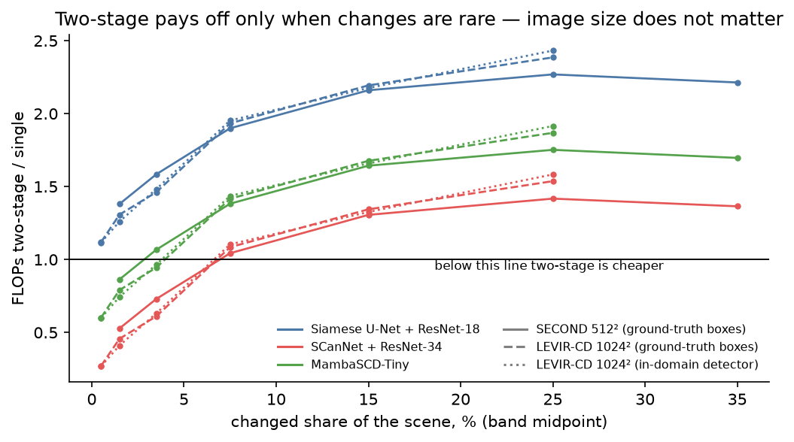</p>

| SCD model | Two-stage is cheaper when… |
|---|---|
| Siamese U-Net (light) | never — the detector alone costs more than the model |
| MambaSCD-Tiny (medium) | changes cover less than ≈ 3 % of the scene |
| SCanNet (heavy) | changes cover less than ≈ 5–10 % of the scene |

This holds only with an **in-domain detector**. A detector trained on SECOND marks ≈ 70 % of a
LEVIR-CD scene as changed, and the savings disappear. On SECOND the average tile has 19 % changed
pixels, which is why no saving appeared there even with a perfect detector.

## Error Analysis

The two-stage system fails to save compute for three reasons:

1. **The detector is not cheap.** BIT costs ≈ 130 GFLOPs per tile — more than the whole U-Net
   (119 GFLOPs).
2. **Context windows add the area back.** The ROI boxes cover ≈ 53 % of a tile, but the 128–512
   context windows around them cover ≈ 105 % (windows overlap).
3. **Missed changes cannot be recovered.** The detector finds 86–89 % of changed pixels; every
   pixel outside the ROIs is predicted as "no change".

For the weak U-Net the detector also *helps*: on tiles with few changes it removes false alarms
outside the ROIs. For the strong models the missed changes outweigh this effect. This explanation is
my interpretation of the strata results and was not measured separately.

On the latency side, box generation, host–device transfers and several small batches per tile cost
more time than the saved area: the two-stage system was 1.8–2.5× slower.

## Interactive Demo

**[Open the demo](https://romanustenko.github.io/projects/satellite-change/)**

The demo shows 15 SECOND validation examples with precomputed predictions of all systems:
- **simple view** — before/after images and the result in plain language;
- **expert view** — class maps, error maps, change probability, class confidence, detector
  probability with ROI windows, and all result tables.

Available in English, German and Russian. The page contains only precomputed maps, no model
weights.

**Simple view** — one example, a model tier and the approach to choose, the result in plain words:

<p align="center">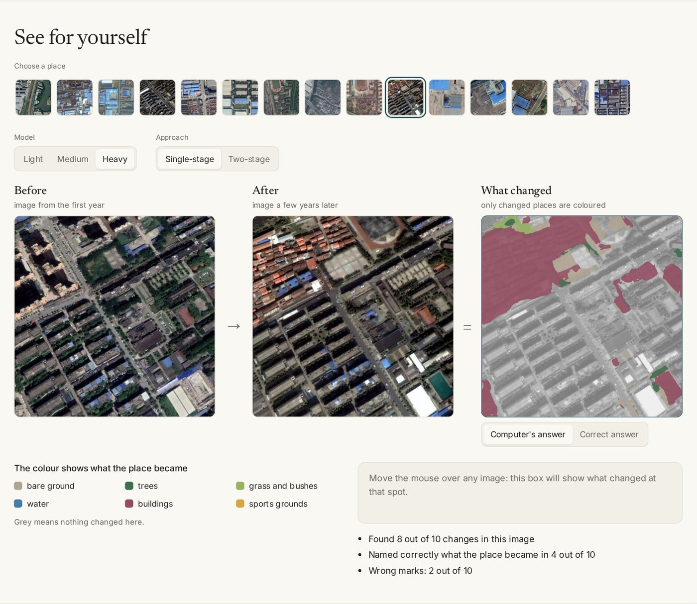</p>

**Expert view, error layer** — single-stage and two-stage side by side: correct, wrong class,
missed and false-alarm pixels against the ground truth:

<p align="center">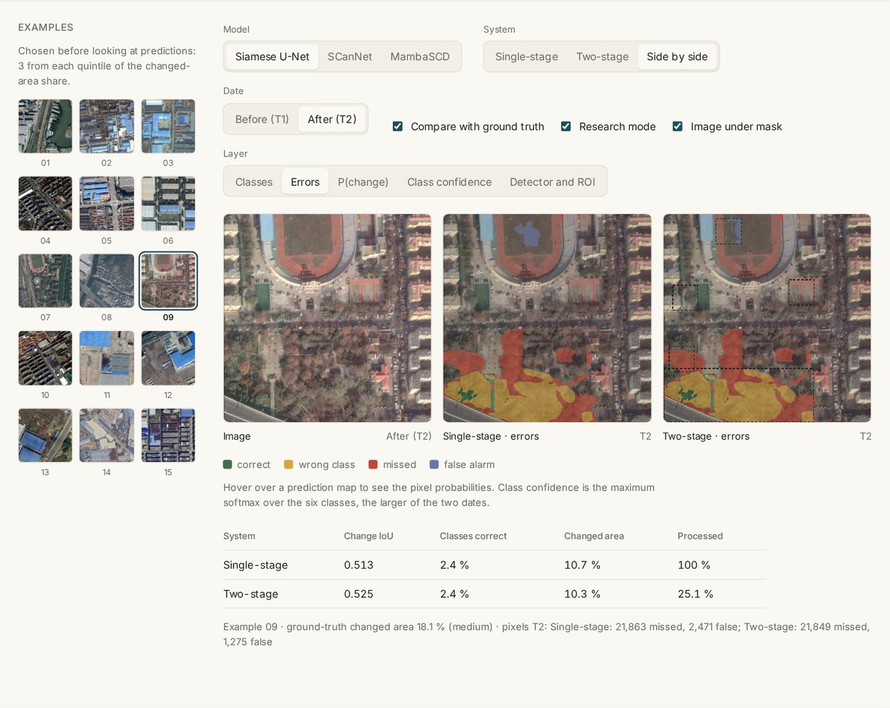</p>

**Expert view, detector layer** — detector probability and the ROI windows the SCD model receives:

<p align="center">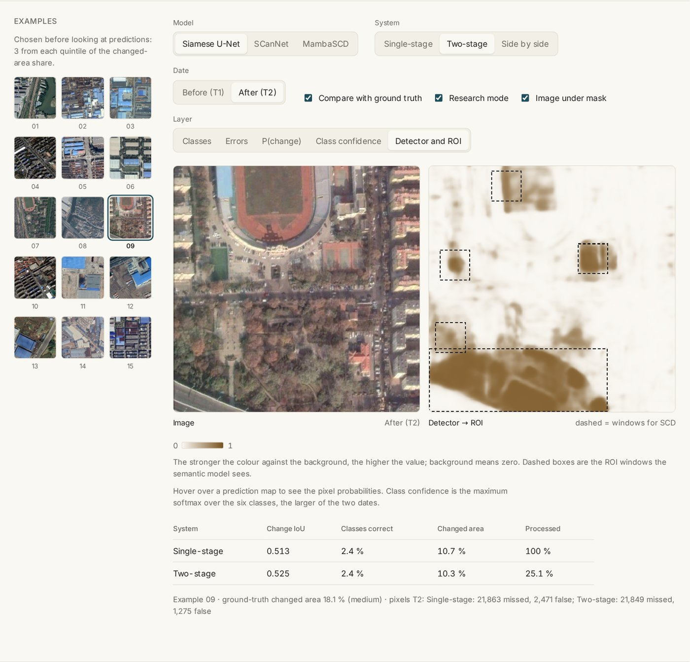</p>

*Note: the "Processed" column of the demo shows the area of the ROI boxes; the context windows
the SCD model actually processes are larger (on average ≈ 1.05 of the tile, see Error Analysis).*

## What I Learned

During this project, I learned:

* how binary and semantic change detection models are built (Siamese CNNs, token transformers,
  hierarchical vision transformers, state-space models) — for model and training choices I consulted
  an AI assistant and then re-implemented and re-ran the code myself to understand it;
* how to design and run a staged hyperparameter search by hand, read the training curves of
  hundreds of trials and decide what to try next;
* why every decision needs a reason I can defend: why these models and not others, why this
  resolution, why this loss, why this ROI policy;
* how to make a comparison fair: equal training compute measured in FLOPs, selection on validation
  only, a frozen protocol and a single read of the test split;
* how to judge "as good as" correctly with non-inferiority tests, paired bootstrap confidence
  intervals and multiple-comparison correction;
* that the cost of a system can often be predicted on paper before running expensive experiments;
* that a negative result is a result: knowing *when* an idea does not work is as useful as knowing
  when it does;
* how to work on a shared GPU server: resumable training, reproducibility records, and not
  disturbing other people's jobs.

## Limitations

- One dataset per study (LEVIR-CD, SECOND), one implementation of each architecture, three seeds.
  SECOND has no geographic metadata, so spatial dependence between tiles is not modelled.
- ROI policies and δ were chosen on the same validation tiles used to select checkpoints, which is
  optimistic for the two-stage systems.
- The SCD models were trained on whole tiles and only *applied* to ROI windows.
- Our absolute SeK is below published numbers: the training budget is smaller and one shared recipe
  was used for all models.
- The cost check on larger scenes measures compute only; accuracy at very low change shares is
  untested.

## Next Steps

- Test accuracy on large real scenes with few changes (e.g. HRSCD, 10 000² pixels).
- Use a detector that is much cheaper than the SCD model, so that even the light model can profit.
- Reduce the latency overhead of the two-stage pipeline (box generation, transfers, batching).

## Implementation Overview

```text
src/satchange/     library: data loaders, models, training and HPO engine, SCD metrics,
                   ROI extraction, two-stage evaluation, latency, statistics, freeze manifest
src/scripts/       Research 2 runners: training, HPO, evaluation, analysis, figures, web export
configs/           Research 1 experiment configs
notebooks/         research_1/ (training, HPO and hypothesis notebooks), research_2/
tests/             pytest suite (CPU, synthetic data)
assets/readme/     figures of this README
artifacts/         run outputs (not in git); final Research 1 detectors in artifacts/final_models (Git LFS)
data/              datasets (not in git)
```

## How to Run

```bash
git clone https://github.com/romanustenko/satellite-change-intelligence.git
cd satellite-change-intelligence
python -m venv .venv && source .venv/bin/activate
pip install -e .
```

Notes:
- Python 3.11 and PyTorch with CUDA. MambaSCD also needs the `selective_scan` CUDA kernel from
  ChangeMamba.
- Download SECOND and LEVIR-CD yourself. The frozen SECOND split is
  `data/SECOND/second_split_manifest.json`.
- Research 2 pipeline (each script documents its arguments): `run_r2_v2_hpo.py` →
  `run_r2_v2_scd.py` → `run_r2_v2_detector.py` → `prepare_r2_v2_val.py` → `freeze_r2_v2.py` →
  `eval_r2_v2_systems.py` → `analyze_r2_v2_systems.py` → `make_r2_v2_results.py`.
- Figures of this README: `python src/scripts/make_readme_figures.py --demo <web-demo>/public`.

---

## Acknowledgements

I thank **Prof. Christian Gawron** and **Hochschule Südwestfalen** for providing the GPU server
(4 × NVIDIA A100 80 GB) on which all experiments of this project were run.

I used documentation, papers, and AI-based assistance to clarify concepts, compare implementation
choices, debug errors and write parts of the code. The research questions, the study design, the
hyperparameter searches of Research 1, the decisions recorded in [REPORT.md](REPORT.md) and the
final review of all results were made by me.

Datasets and third-party work:
- SECOND — Yang et al., *Asymmetric Siamese Networks for Semantic Change Detection in Aerial Images*
  (IEEE TGRS 2021). Images are shown here for educational purposes only.
- LEVIR-CD — Chen & Shi, *A Spatial-Temporal Attention-Based Method and a New Dataset for Remote
  Sensing Image Change Detection* (Remote Sensing 2020).
- MambaSCD — ported from [ChangeMamba](https://github.com/ChenHongruixuan/MambaCD)
  (Apache-2.0, licence notice kept).
- SCanNet — reimplemented from Ding et al. (IEEE TGRS 2024); no code copied.
- BIT (Chen et al. 2021), FC-Siam-Diff (Daudt et al. 2018), SegFormer / MiT (Xie et al. 2021).

Datasets and run outputs are not included in the repository. The six final Research 1 detectors
are stored with Git LFS in `artifacts/final_models/`; the Research 2 SCD weights are not published.
