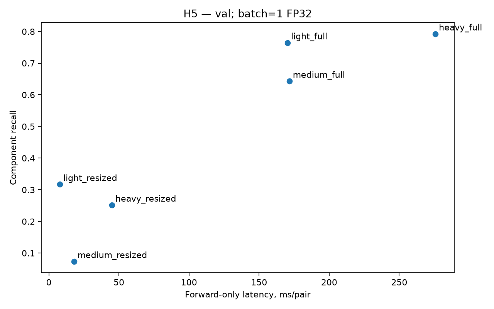
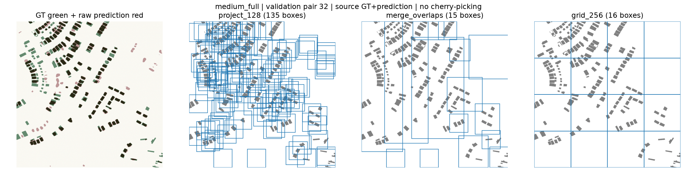

# Satellite Change Intelligence — full report

> The short version is the [README](README.md). This document is for readers who want the whole
> story of both studies: how each was designed, what was found, which decisions were taken and why,
> and what went wrong on the way.

The project consists of two studies on one PyTorch codebase:

- **[Part I — Research 1](#part-i--research-1-binary-change-detection-levir-cd):** binary change
  detection on LEVIR-CD — *where* did something change? Three detector tiers trained and tuned by
  hand, then eleven hypothesis series about resolution, errors, cost and ROI generation.
- **[Part II — Research 2](#part-ii--research-2-single-stage-vs-two-stage-semantic-change-detection-second):**
  semantic change detection on SECOND — *what* changed into what? Is a two-stage system
  (detector from Research 1 → ROI → semantic model) preferable to a single semantic model?

## Contents

**Part I — Research 1 (LEVIR-CD)**
- [1.1 Question and setup](#11-question-and-setup)
- [1.2 Hyperparameter search](#12-hyperparameter-search)
- [1.3 Final detectors](#13-final-detectors)
- [1.4 Hypotheses H1–H5](#14-hypotheses-h1h5)
- [1.5 ROI experiments H08–H11](#15-roi-experiments-h08h11)
- [1.6 What Research 1 handed over](#16-what-research-1-handed-over-to-research-2)
- [1.7 Mistakes and lessons](#17-mistakes-and-lessons-research-1)

**Part II — Research 2 (SECOND)**
- [2.1 Motivation and question](#21-motivation-and-question)
- [2.2 Timeline](#22-timeline)
- [2.3 First iteration: GPU-hour budget](#23-first-iteration-v1-gpu-hour-budget)
- [2.4 Study design v2](#24-study-design-v2)
- [2.5 Hypotheses and outcomes](#25-hypotheses-and-outcomes)
- [2.6 Results](#26-results)
- [2.7 When does a two-stage system pay off?](#27-when-does-a-two-stage-system-pay-off)
- [2.8 Key decisions](#28-key-decisions)
- [2.9 Mistakes and lessons](#29-mistakes-and-lessons-research-2)
- [2.10 Limitations](#210-limitations)
- [2.11 Future work](#211-future-work)
- [2.12 Reproducibility](#212-reproducibility)

---

# Part I — Research 1: Binary change detection (LEVIR-CD)

## 1.1 Question and setup

**Question:** how do input resolution and model size affect *what* a binary change detector finds
— and what would it cost to use such a detector as the first stage of a two-stage system?

**Data.** LEVIR-CD: 637 pairs of 1024 × 1024 images (0.5 m / px), binary building-change masks,
official train / validation / test split. Validation: 64 pairs with 2 788 changed objects
(connected components); test: 128 pairs with 7 027 objects.

**Models** — three tiers, each trained in two input regimes:

| Tier | Model | Idea |
|---|---|---|
| Light | FC-Siam-Diff | small fully convolutional Siamese network; feature differences at every scale |
| Medium | BIT (ResNet-18 S4, 8-layer decoder) | CNN features + a transformer over a few semantic tokens |
| Heavy | Siamese MiT-B3 (SegFormer encoder) | hierarchical vision transformer |

- **Full:** native 1024 × 1024 input.
- **Resized:** the whole scene downscaled to 256 × 256 (16× fewer pixels).

## 1.2 Hyperparameter search

The search was done by hand, in stages; I inspected every stage before choosing the next one. The
compute budget was deliberately not limited, so that slower schedules and larger grids could be
tried, and settings that looked worse at first could be revisited.

| Tier | Procedure |
|---|---|
| Light | learning-rate and batch-size screens → limited grid → loss → weight decay → model capacity → candidates a–h over three seeds → deterministic reproducibility checks |
| Medium | six stages: lr × batch → architecture → BCE/Dice weights → weight decay → lr refinement → batch × lr; multi-seed confirmation; final 100-epoch training |
| Heavy | own resumable, staged HPO controller (40 → 60 → 80 epochs), because single trials took many hours on the shared server and were interrupted |

In total **542 trials**. Every trial record (parameters, learning curves, best epoch, selected
threshold, GPU time) is kept in `artifacts/hyperparameter_search/`. Thresholds were always selected
on validation.

GPU time was recorded per trial as the cost measure. Its weakness on a shared server
(the same job taking very different times depending on other people's load) became clear only in
Research 2 (§2.3) and led to measuring compute in FLOPs.

## 1.3 Final detectors

LEVIR-CD test, mean ± SD over 3 seeds (Heavy Resized: 1 seed):

| Tier | F1 Full (1024²) | IoU Full | F1 Resized (256²) | IoU Resized | Forward latency Full / Resized |
|---|---:|---:|---:|---:|---:|
| Light · FC-Siam-Diff | 0.805 ± 0.038 | 0.675 | 0.737 ± 0.018 | 0.584 | ≈ 170 / 8 ms |
| Medium · BIT | 0.846 ± 0.007 | 0.733 | 0.684 ± 0.023 | 0.520 | ≈ 172 / 18 ms |
| Heavy · MiT-B3 | **0.867 ± 0.003** | **0.765** | 0.746 | 0.595 | ≈ 276 / 45 ms |

Latency: model forward only, batch 1, fp32, A100 — no I/O, resizing or ROI generation.

Note: Full and Resized are not a perfectly controlled resolution ablation — the tuned
hyperparameters differ between regimes (e.g. BIT's embedding size 64 vs 32).

## 1.4 Hypotheses H1–H5

After training, I formulated five hypotheses about *why* the detectors differ. They were tested on
the test split with paired bootstrap over image pairs (95 % CI).

| | Hypothesis | Key evidence | Outcome |
|---|---|---|---|
| H1 | Full resolution helps more for **small** objects than for large ones | contrast (Full − Resized) object recall, small − large: Light **+0.131** [0.058, 0.197], Heavy **+0.228** [0.131, 0.318], Medium −0.040 [−0.143, 0.053] | **supported for Light and Heavy**, not for Medium; depends on threshold and metric |
| H2 | Heavy's higher F1 comes mainly from **better boundaries** | Heavy − Light: boundary F1 **+0.046**, object recall +0.020 (n.s.); Heavy − Medium: boundary F1 +0.066, object recall **+0.160** | **partly:** boundaries are better, but Heavy also has far fewer false alarms away from objects — not "mainly boundaries" |
| H3 | Different architectures make **complementary errors**; an OR-ensemble recovers misses | at matched pixel recall ≈ 0.93: Light+Heavy OR object recall **0.606** vs Heavy 0.511 vs Light 0.399 | **supported**, but the ensemble costs the sum of both detectors (≈ 446 ms) |
| H4 | Higher **pixel F1** does not imply higher **object recall** | Medium Full F1 0.848 > Light Full 0.841, but object recall 0.593 < **0.733**; Medium Resized object recall only 0.050 (merged objects) | **supported** |
| H5 | More compute does not give proportionally more benefit | Heavy Full: best F1 and object recall, but 1.6× the latency of Light/Medium Full; Resized models 6–20× faster but miss most small objects | **supported**; a fixed alert budget (18 per pair) was too strict to rank models |

<p align="center">

</p>

## 1.5 ROI experiments H08–H11

H4 showed that neither pixel F1 nor object recall says whether the regions handed to a second
stage actually *contain* the changes. The following series therefore evaluated detectors as ROI
generators. They used **validation only** (H10–H11: 32 development + 32 audit pairs).

| Series | Question | Main finding |
|---|---|---|
| H08 | Which detector + threshold gives the best ROIs? Is Medium's low object recall a bad seed? | Medium's low object recall is reproducible over 3 seeds; its ROIs still cover ≈ 97 % of objects. OR-ensemble: +0.5 pp coverage for +170 ms. |
| H09 | Medium vs Light at **matched** ROI coverage (≈ 97.5 %) | Medium needs **10 fewer crops per pair** (CI −13.6…−6.7) and **15 pp less processed area**; 135 objects were covered by crops although the mask had no overlap with them |
| H10 | Do other ROI generators or mask post-processing change the picture? | the generator changes the ranking: with a 128-px grid Medium's advantage shrinks from 10 to ≈ 1 crop; random crops of equal budget cover only 43–46 % of objects |
| H11 | Grid tile size 32–256, margins, adaptive merging, all six models | 32-px tiles cover 87 % of objects by union but only **5 %** by a single crop; 256-px tiles + 16-px margin reach 98 % single-crop coverage at ≈ 52–58 % processed area |

<p align="center">

</p>

**Lesson of H08–H11:** the ROI policy decides the cost at least as much as the detector — the same
detector output can produce 15 or 135 boxes. "Coverage by the union of all crops" is misleading
for a second stage that processes crops independently; coverage by a *single* crop is the relevant
measure.

## 1.6 What Research 1 handed over to Research 2

- **Detector candidates:** Light, Medium and Heavy Full, plus the OR-ensemble as an option. BIT
  (Medium) was later chosen by a screening on SECOND (§2.4).
- **ROI design:** context windows of a few fixed sizes (128 / 256 / …) instead of tiny tiles or exact
  boxes; the policy must be selected on validation together with the detector.
- **The main cost question:** how much of the image does the second stage still have to process,
  and does that save anything once the detector's own cost is counted?

## 1.7 Mistakes and lessons (Research 1)

1. **Notebooks are not a lab journal.** I edited the training notebooks again and again while the
   training functions changed, so their code no longer matches their saved outputs. What saved the
   history were the per-trial records in `artifacts/`. *Lesson:* keep code in a versioned library,
   let notebooks only call it, and write every run's parameters and results to disk.
2. **Hypotheses H1–H5 and their follow-ups were evaluated on the test split.** With many thresholds
   and configurations, this makes the test split part of the exploration. From H08 on I used
   validation only; in Research 2 the test split was read exactly once, after a hashed freeze.
3. **Metrics can disagree** (H4). Choosing one headline metric too early would have hidden the most
   interesting behaviour of BIT.
4. **An arbitrary constraint is not informative** (H5): the 18-alerts budget excluded almost every
   model. Pareto fronts over several costs were more useful.
5. **Forward latency is not system cost.** The H5 latencies exclude ROI extraction, transfers and
   the second stage; Research 2 showed that exactly these parts dominate a two-stage pipeline.

---

# Part II — Research 2: Single-stage vs two-stage semantic change detection (SECOND)

## 2.1 Motivation and question

Semantic change detection answers two questions at once: **where** did something change between
two images, and **what** was it before and after. Models that do both are expensive. A natural
engineering idea is to split the work: a cheap binary detector finds candidate regions, and the
expensive semantic model looks only at those regions.

**Central question:** *under which accuracy and compute conditions is a two-stage semantic change
detection system preferable to a single-stage one?* A negative answer was declared a valid outcome
from the start.

## 2.2 Timeline

| When (2026) | Phase | Outcome |
|---|---|---|
| Nov 6–10 | **Iteration v1:** one self-built semantic model vs one two-stage system; budget in GPU-hours | two-stage slower and less accurate — but the study compared the wrong things and the budget unit was unreliable (§2.3); archived |
| Nov 10 | **Scope correction:** 4 system types × 3 published SCD architectures, equal-FLOP budget | design v2 written down before any new code |
| Nov 10–12 | Detector screening on SECOND validation | Medium (BIT) chosen for the two-stage systems |
| Nov 12–13 | Pilot: learning rate and common training budget | budget b* = 3.2 × 10¹⁷ FLOPs per final run |
| Nov 16–18 | HPO (6 trials per model, equal FLOPs) | learning rate / weight decay per model |
| Nov 18–21 | Final training, 3 seeds × 3 models; ROI policies on validation; freeze | protocol v0.4 frozen with hashes |
| Nov 21–22 | **Test split read once**; analysis; latency | results below |
| Nov 22–23 | Web demo; exploratory cost checks (§2.7) | this report |

## 2.3 First iteration (v1): GPU-hour budget

**Design.** System A = one self-built semantic model (FC-Siam encoder, date-aware decoder) on the
whole tile. System B = BIT detector (LEVIR-CD → SECOND) → ROI crops → the same kind of semantic model,
trained on ROI windows. The compute budget was a **project-wide cap of 120 allocated GPU-hours**
(soft limit 100), split between the components.

**Hypotheses (v1):**

| | Hypothesis | Outcome (test, 3 seeds) |
|---|---|---|
| H-A | For tiles with few changes, B is non-inferior in SeK **and** faster than A | **not supported:** B − A = −0.0095 SeK [−0.0121, −0.0069]; B 4.2–5.2× slower in every density stratum |
| H-B | B's latency ratio grows with the changed share and exceeds 1 above some density | **partly:** the ratio grows (4.2 → 4.9 → 5.2), but it is above 1 everywhere — the detector alone (17 ms) costs more than all of A (7 ms) |
| H-C | B's errors come mainly from changes the detector missed | **not supported:** 41 % of missed changed pixels lie outside the ROIs, 59 % inside (semantic-model errors) |
| H-D | Initialising the detector from LEVIR-CD needs fewer GPU-hours to reach a target F1 on SECOND than training from scratch | **supported** (pilot, 3/3 seeds): target reached after 3–13 instead of 19–23 epochs |

**Why GPU-hours failed as a budget.** The same 40-epoch pilot job took ≈ 0.4 h on an idle A100
and 1.7–2.5 h when other people's jobs were running — a factor of 4–6 that has nothing to do with
the model. H-D therefore had to be judged in *epochs*, not in GPU-hours, and a GPU-hour cap would
have given models different amounts of training depending on the server load. In v2 the budget is
measured in **training FLOPs** and converted into a fixed number of optimizer steps; GPU-hours are
only reported.

**Why v1 was archived.** Besides the budget unit, v1 compared one self-built model with one two-stage
system, while the intended study compares published architectures of different complexity in four
system types. v1 cost ≈ 80 GPU-hours; its infrastructure (SECOND loaders, SCD metrics, ROI
extraction, latency harness, bootstrap statistics, freeze manifest) was reused in v2.

## 2.4 Study design (v2)

### Systems (12)

| Case | System | Detector (*where*) | Semantic model (*what*) |
|---|---|---|---|
| 1 | single-stage | — | whole 512² tile |
| 2 | two-stage | BIT, pre-trained on LEVIR-CD, fine-tuned on SECOND | context windows around detected boxes |
| 3 | two-stage | BIT trained on SECOND only | same |
| 4 | two-stage | OR-ensemble: BIT ∨ FC-Siam-Diff (Resized) | same |

× three semantic models, ordered by complexity:
**Siamese U-Net + ResNet-18** (CNN), **SCanNet + ResNet-34** (CNN + transformer),
**MambaSCD-Tiny** (state-space model). The two-stage systems reuse exactly the single-stage
checkpoint — only the input changes — so any difference comes from the detector and the cropping.

**Two-stage mechanics:** detector probability map → threshold → connected components → boxes
(margin, merge gap, minimum side) → each box is processed in the smallest 128/256/384/512 window
that contains it → predictions merged back; everything outside the boxes is "no change", so a missed
change is an error.

**Detector choice.** Light, Medium and Heavy were fine-tuned on SECOND train under equal FLOPs and
compared on validation by a rule fixed beforehand; Medium (BIT) was chosen.

### Data

SECOND: 4 662 pairs of 512 × 512 aerial images, six land-cover classes (non-vegetated ground, tree,
low vegetation, water, building, playground) plus "no change". The official training set was split
into train 2 524 / validation 444 by filename groups (frozen manifest); the official test set
(1 694 tiles) was used once.

### Metrics

- **SeK** (primary): Cohen's kappa on the semantic confusion matrix with the dominant
  "no change → no change" cell removed, multiplied by `exp(IoU_change − 1)` — it punishes both wrong
  classes and wrong localisation. Typical published values on SECOND are ≈ 0.20–0.25.
- mIoU and Fscd (secondary); forward FLOPs per tile (incl. the detector); wall-clock latency
  (batch 1, fp32, A100, paired per tile).

### Fairness rules

- **Equal training FLOPs** for every semantic model (HPO included), turned into a fixed step count.
  Equal FLOPs means the light model makes ~8× more optimizer steps than SCanNet — that is intended.
- Selection (hyperparameters, checkpoints, thresholds, ROI policies) only on validation.
- 3 seeds; paired scene bootstrap nested with seeds; 9 pre-declared primary comparisons with Holm
  correction; everything else labelled exploratory.
- **Decision rule (frozen before the test):** two-stage is *preferable* only if it is non-inferior
  in SeK (95 % CI lower bound > −δ, δ = 0.007) **and** cheaper in FLOPs; better but dearer = trade-off;
  non-inferior but dearer = single-stage preferable.

## 2.5 Hypotheses and outcomes

| | Hypothesis | Outcome |
|---|---|---|
| H1 | At equal training FLOPs the three single-stage models differ | **yes:** SCanNet 0.238 ≳ MambaSCD 0.233 ≫ U-Net 0.185 SeK |
| H2 | Two-stage is non-inferior in SeK (central) | **yes** for all three — but more expensive, so never *preferable* |
| H3 | LEVIR-CD pre-training of the detector helps (case 2 > case 3) | **not shown** (≤ +0.001 SeK, Holm p ≥ 0.19) |
| H4 | The OR-ensemble detector helps (case 4 > case 2) | **not shown** (Holm p ≥ 0.23) |
| H5 | The two-stage effect depends on the share of changed pixels | **yes:** U-Net gains only on sparse tiles; strong models lose least on dense tiles |
| H6 | Training the semantic model on ROI crops instead of whole tiles does **not** improve the two-stage SeK (exploratory, my prediction: "crops ≈ tiles or worse") | **holds** (validation, 1 seed): crop − tile two-stage ΔSeK −0.0023 / −0.0044 / −0.0002 (U-Net / SCanNet / MambaSCD), all CIs include 0; with crops two-stage is not non-inferior to single-stage for any model |

**H6 in detail (ablation B).** Each semantic model was trained again from ImageNet initialization
only on context windows (128–512 px) around the ground-truth changes, with the same budget
(3.2 × 10¹⁷ FLOPs) and the HPO-winning lr / weight decay; seed 42, validation only, checkpoint
selected on validation. Validation SeK (tile-trained → crop-trained):

| SCD model | Whole tile | Detector ROI (case 2) | Ground-truth ROI | Crop two-stage − single (95 % CI) |
|---|---|---|---|---|
| Siamese U-Net | 0.1733 → 0.1694 | 0.1715 → 0.1691 | 0.1843 → 0.1837 | −0.0042 (−0.0122…+0.0039) |
| SCanNet | 0.2247 → 0.2182 | 0.2154 → 0.2109 | 0.2410 → 0.2398 | −0.0137 (−0.0231…−0.0051) |
| MambaSCD | 0.2152 → 0.2124 | 0.2049 → 0.2046 | 0.2283 → 0.2286 | −0.0106 (−0.0205…−0.0003) |

Crop training changes nothing even with perfect ROIs, so the two-stage loss comes from the detector
(missed changes), not from a train/test mismatch of the semantic model. No density stratum shows a
significant difference (crops tend to help slightly on sparse tiles and hurt on dense ones). The
result matches the prediction I recorded before the runs. Raw numbers:
[`results/research2/ablation_h6/`](results/research2/ablation_h6/).

## 2.6 Results

### Main table (test, primary ROI policy)

| Model | Case | SeK | ΔSeK vs single (CI95) | FLOPs × | Box / window area | Verdict |
|---|---|---|---|---|---|---|
| U-Net | 1 | 0.1853 | — | 1.00 | — | — |
| U-Net | 2 | 0.1871 | +0.0018 (+0.0009…+0.0027) | 2.14 | 0.53 / 1.05 | trade-off |
| U-Net | 3 | 0.1870 | +0.0017 (+0.0006…+0.0027) | 2.13 | 0.53 / 1.04 | trade-off |
| U-Net | 4 | 0.1878 | +0.0025 (+0.0015…+0.0035) | 2.06 | 0.49 / 0.90 | trade-off |
| SCanNet | 1 | 0.2381 | — | 1.00 | — | — |
| SCanNet | 2 | 0.2341 | −0.0040 (−0.0053…−0.0027) | 1.28 | 0.53 / 1.05 | single |
| SCanNet | 3 | 0.2331 | −0.0049 (−0.0065…−0.0034) | 1.27 | 0.53 / 1.04 | single |
| SCanNet | 4 | 0.2337 | −0.0044 (−0.0060…−0.0029) | 1.15 | 0.49 / 0.90 | single |
| MambaSCD | 1 | 0.2329 | — | 1.00 | — | — |
| MambaSCD | 2 | 0.2292 | −0.0038 (−0.0051…−0.0025) | 1.62 | 0.53 / 1.05 | single |
| MambaSCD | 3 | 0.2284 | −0.0046 (−0.0061…−0.0030) | 1.61 | 0.53 / 1.04 | single |
| MambaSCD | 4 | 0.2287 | −0.0043 (−0.0057…−0.0028) | 1.51 | 0.49 / 0.90 | single |

Latency (case 2 vs single, median of per-tile ratios): U-Net ×2.45, SCanNet ×1.92, MambaSCD ×1.99.

### Accuracy–compute curve (case 2, all four ROI policies)

| Model | balanced | frontier0.7 | frontier0.5 (primary) | frontier0.3 |
|---|---|---|---|---|
| U-Net | +0.0001 / ×2.12 | +0.0011 / ×2.09 | +0.0018 / ×2.14 | −0.0100 / ×1.76 |
| SCanNet | −0.0001 / ×1.27 | −0.0006 / ×1.24 | −0.0040 / ×1.28 | −0.0307 / ×0.91 |
| MambaSCD | −0.0003 / ×1.61 | −0.0003 / ×1.57 | −0.0038 / ×1.62 | −0.0295 / ×1.24 |

Only one configuration is cheaper than the single stage (SCanNet, frontier0.3), and it loses
0.031 SeK.

### Density strata (H5; ΔSeK case 2 − single)

| Share of changed pixels ρ | U-Net | SCanNet | MambaSCD |
|---|---|---|---|
| ρ < 0.115 (574 tiles) | **+0.0030** | −0.0062 | −0.0073 |
| 0.115 ≤ ρ < 0.228 (539) | +0.0007 | −0.0071 | −0.0069 |
| ρ ≥ 0.228 (581) | −0.0005 | −0.0025 | −0.0034 |

On dense tiles the boxes cover almost the whole tile and both systems converge. On sparse tiles the
detector matters most: it seems to remove U-Net's false alarms (gain) but, for the stronger models,
its misses outweigh that (loss). `This mechanism is an interpretation, not measured separately.`

### Headroom: oracle ROIs

With boxes taken from the ground truth, every model would gain +0.018 to +0.021 SeK at ≈ 0.98×
FLOPs (no detector charged). The idea has headroom; the real detector (pixel recall 0.86–0.89)
does not capture it.

## 2.7 When does a two-stage system pay off?

Exploratory checks after the test (validation data only, compute only, no accuracy).

**Cost model.** For a scene of area A, with detector cost `C_det`, semantic-model cost `C_scd` and
processed window area W:

```
FLOPs(two-stage) / FLOPs(single) = C_det / C_scd + W / A
```

**Image size cancels out.** Measured forward FLOPs grow exactly with the pixel count for all four
networks (512 → 800 → 1024 → 2048 px), so `C_det / C_scd` is constant: U-Net 1.09, MambaSCD 0.57,
SCanNet 0.24. U-Net can therefore *never* be cheaper in a two-stage system with this detector.

**Window share on real scenes** (ROI settings of the primary policy):

| Scenes | Changed share (mean) | Boxes from | U-Net | SCanNet | MambaSCD |
|---|---|---|---|---|---|
| SECOND val, 512² | 19 % | ground truth | ×2.09 | ×1.24 | ×1.58 |
| SECOND val, 512² | 19 % | case-2 detector | ×2.13 | ×1.27 | ×1.61 |
| LEVIR-CD val, 1024² | 4 % | ground truth | ×1.51 | **×0.67** | ×1.00 |
| LEVIR-CD val, 1024² | 4 % | LEVIR-trained BIT | ×1.52 | **×0.67** | ×1.00 |
| LEVIR-CD val, 1024² | 4 % | SECOND-trained BIT | ×2.01 | ×1.16 | ×1.49 |
| same LEVIR scenes cut to 512² | 4 % | ground truth | ×1.46 | **×0.61** | ×0.95 |

Binned by changed share, the SECOND and LEVIR-CD curves agree. Conclusions:

- Two-stage becomes cheaper only when **changes are rare**: below ≈ 5–10 % of the scene for SCanNet,
  below ≈ 3 % for MambaSCD, never for U-Net.
- The detector must be **in-domain**; a SECOND detector on LEVIR-CD imagery fires on ≈ 70 % of the
  area.
- Larger scenes do not help by themselves (cutting into tiles was even slightly cheaper). Real
  large scenes usually *have* a lower changed share than curated benchmark tiles — that is where the
  savings would come from.
- Open: whether accuracy holds at such low change shares. On SECOND's sparse stratum the strong
  models lost 0.006–0.007 SeK.

## 2.8 Key decisions

| Decision | Why | Alternative rejected |
|---|---|---|
| Measure training compute in FLOPs and stop by step count | GPU-hours on a shared server depend on other people's jobs (§2.3) | project-wide GPU-hour cap (used in v1) |
| Train all three semantic models ourselves | published checkpoints had seen our validation split; MambaSCD's was selected on the test split | compare against published weights |
| Reimplement SCanNet from the paper | its code has no licence | copy the authors' code |
| Use the *same* semantic checkpoint inside the two-stage systems | isolates the effect of detector + cropping | train a separate crop model (checked afterwards as H6: no gain) |
| Choose the detector by a frozen screening rule on validation | avoid picking the detector that happens to look best later | choose by test or by intuition |
| Context windows of fixed sizes (128/256/384/512) | windows of equal size can be batched on the GPU (lesson of H10–H11) | exact box crops (one forward pass per box, used in v1) |
| Non-inferiority margin δ and density strata fixed by a mechanical rule before the test | no room to tune the conclusion | choose δ after seeing results |
| Read the test split exactly once, through a hashed freeze manifest | the test result must not influence any choice (lesson of Research 1) | iterate on test |
| Publish only precomputed masks in the demo, no weights | dataset and model licences | interactive inference online |

## 2.9 Mistakes and lessons (Research 2)

1. **The first iteration studied the wrong thing.** The intended design (four system types, three
   published architectures) was in my head but not on paper; v1 compared one self-built model with
   one two-stage system. Four days and ≈ 80 GPU-hours were archived.
   *Lesson:* write the design — what is compared and how it is judged — before writing code.
2. **A GPU-hour budget on a shared server is not a fair budget** (§2.3). Throughput changed 4–6×
   with other people's load. Switched to training FLOPs and fixed step counts.
3. **The test split was read in v1 for preliminary systems.** The v2 systems are new and frozen
   separately, but aggregate v1 numbers were known — documented as a threat to validity.
4. **The first ROI-settings grid could not reach small area budgets** (minimum 0.47 of the tile), so
   one robustness metric measured the grid edge, not noise. Found during noise calibration, *before*
   the rule was frozen; the grid was extended from 180 to 324 settings.
5. **Learning-rate probes ended at the grid edge** for all three detectors (best = largest value) and
   the grid was not extended. Possibly none of the detectors is at its optimal learning rate.
6. **Equal FLOPs ≠ equal opportunity.** At the screening budget the Heavy detector got only ≈ 6
   epochs and was undertrained; a 5× longer run (one seed) reached F1 0.694 vs Medium 0.688.
7. **The cost could have been predicted on paper.** The formula in §2.7 with the measured detector
   cost and window area explains the main result. A back-of-the-envelope cost model before the
   experiments would have shown which conditions to test.
8. **Long runs on a shared server get interrupted.** Five final runs were resumed exactly from
   their last checkpoint after restarts; one detector run was started twice by mistake (duplicate
   killed, integrity checked). Resumable training paid off.
9. **Latency on a shared GPU:** foreign load appeared during the measurement; ratios are paired per
   tile and robust, absolute milliseconds may be inflated.
10. **Demo details matter:** an inverted colour legend in dark mode, maps blocking touch scrolling,
    and a "processed area" column showing the box instead of the window area (now corrected) — all
    found by testing the page as a user.

What I learned from both studies is summarised in the [README](README.md#what-i-learned).

## 2.10 Limitations

- One dataset (SECOND), one implementation per architecture, three seeds; no geographic metadata,
  so spatial dependence between tiles is not modelled.
- ROI policies, ensemble partner and δ were chosen on the same validation tiles used to select
  checkpoints (optimistic for the two-stage systems).
- The semantic models of the main study were trained on whole tiles and only applied to ROI windows.
  The crop-trained variant (H6) is exploratory: validation only (also used for checkpoint selection),
  one seed, ground-truth crops only (no false or truncated detector crops in training).
- Our absolute SeK is below published numbers: smaller training budget and a shared recipe.
- §2.7 measures compute only; accuracy on large, sparse scenes is untested.

## 2.11 Future work

- **Accuracy on large real scenes** with low change share (e.g. HRSCD, 10 000² px, semantic labels).
- **A cheaper detector:** U-Net would need a detector well below its own cost.
- **Engineering the latency:** box generation, host round trips and small batches cost more time
  than the saved area.

## 2.12 Reproducibility

- Exact commands for every step (environment, weights, detectors, HPO, final runs, freeze, test
  read): [REPRODUCE.md](REPRODUCE.md).
- Every run records git revision, PyTorch/CUDA versions, GPU model, steps and FLOPs.
- Frozen protocol and code are hashed in a freeze manifest; the single test read is recorded.
- MambaSCD's `selective_scan` backward pass is not bitwise deterministic; its runs rely on seeds.
- Compute: 1.44 × 10¹⁸ training FLOPs per semantic model (HPO 4.8 × 10¹⁷ + finals 9.6 × 10¹⁷),
  4 × A100-80GB shared server.
